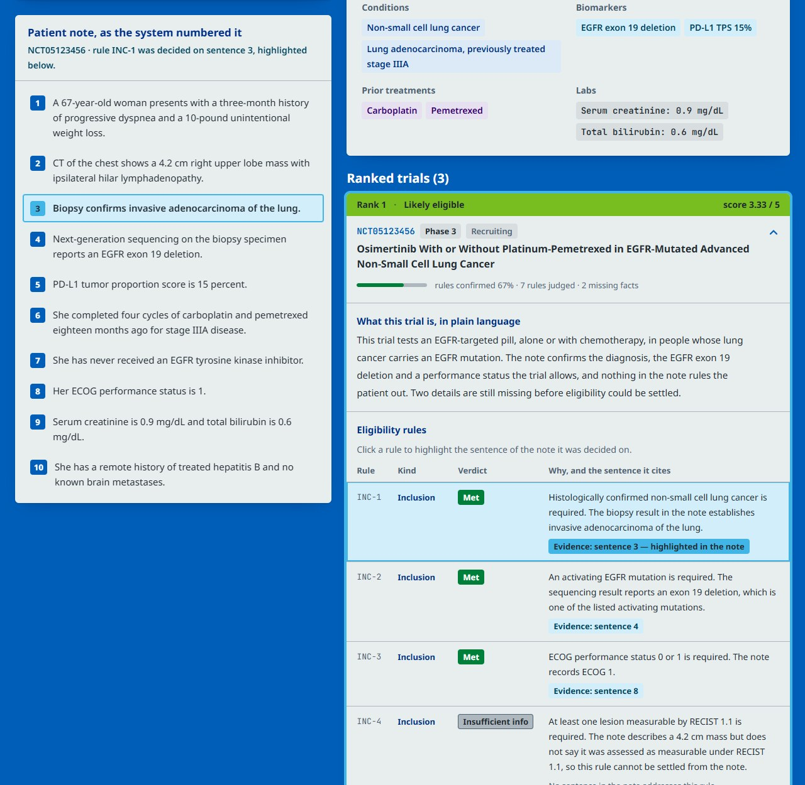
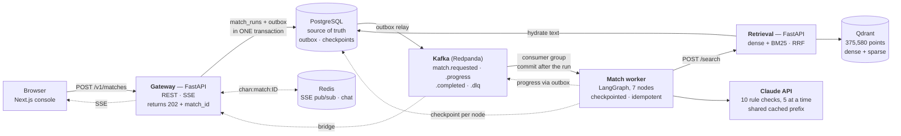

# Beacon

**Clinical-trial matching with RAG: a patient note in, a ranked list of trials
out, with every eligibility decision traced to the sentence it came from.**

> **Decision support, not medical advice.** Beacon is a research and portfolio
> system evaluated on the public TREC Clinical Trials benchmark with
> **synthetic** patient notes. It has no clinical validity, it must not be used
> for care decisions, and no real patient record should ever be entered into it.



*Clicking a rule highlights the sentence of the patient note it was decided on.
The screenshot shows the console's built-in sample run.*

## At a glance

- **375,580 real ClinicalTrials.gov trials indexed.** Each trial is stored as
  both a BM25 keyword vector and a dense embedding in Qdrant, with the full text
  in PostgreSQL.
- **Hybrid search measured on TREC Clinical Trials 2021.** Fusing keyword and
  vector search with Reciprocal Rank Fusion improves top-10 ranking quality by
  **34% over BM25** (nDCG@10 0.254 → 0.340, non-overlapping 95% bootstrap
  intervals). Median search time is **89 ms** per query on a laptop CPU. See
  [Results](#results).
- **Claude checks every eligibility rule** of the top 10 trials and cites the
  note sentences it relied on. Citations are checked in code, and the final
  verdict is computed in code, never by the model.
- **Async and crash-safe.** The API answers `202` immediately, and Kafka with a
  transactional outbox carries the job to a LangGraph worker. The worker
  checkpoints every step to PostgreSQL, so a crashed run resumes without
  repeating paid LLM calls. Progress streams to the browser over SSE.
- **Evaluation-driven.** A cross-encoder reranker was measured, found to add no
  quality, and switched off, which saves 34–50 s per match.

---

## Try it locally

There are two ways to try it, depending on how much time you have.

### Option A: the console with a sample run (2 minutes, free, no API key)

All you need is [Node.js](https://nodejs.org) 20 or newer.

```bash
git clone https://github.com/hasanmahdi2007/Beacon-AI-Clinical-Trial-Matching.git
cd Beacon-AI-Clinical-Trial-Matching/web
npm install
npm run dev
```

Open <http://localhost:3000> and click **Load sample run**. It replays a saved
run through exactly the screens a live run uses: the pipeline steps, the
patient summary, the ranked trials and the rule table. Click any rule to see
its evidence highlighted in the note. Nothing calls an API.

### Option B: the full system on your machine

This runs the real pipeline: ingestion, hybrid search, Kafka, the LangGraph
worker and live Claude calls.

**You need:**
- **Docker Desktop**, running.
- **[uv](https://docs.astral.sh/uv/)**, the Python package manager. On Windows:
  `irm https://astral.sh/uv/install.ps1 | iex`. On macOS or Linux:
  `curl -LsSf https://astral.sh/uv/install.sh | sh`.
- **Node.js 20+**.
- **About 25 GB of free disk** outside the repo, for the TREC corpus and the
  index.
- **An Anthropic API key**, for live matches only. Each match costs an
  estimated $0.05 on Haiku: about 27 Claude calls for 10 trials.

**1. Install and configure**

```powershell
git clone https://github.com/hasanmahdi2007/Beacon-AI-Clinical-Trial-Matching.git
cd Beacon-AI-Clinical-Trial-Matching
uv sync --locked
Copy-Item .env.example .env        # macOS/Linux: cp .env.example .env
```

In `.env`, set three values:
- `ANTHROPIC_API_KEY`
- `BEACON_IR_DATASETS_HOME`, a folder **outside** the repo for the corpus
- `IR_DATASETS_HOME`, set to the same folder

**2. Start the databases and create the schema**

```powershell
docker compose -f deploy/compose.yaml up -d --wait   # Postgres, Redis, Qdrant, Redpanda, Phoenix
uv run alembic upgrade head
```

`--wait` returns only once every container reports **healthy**.

**3. Download and index the trials**

```powershell
# Download the TREC corpus once (about 1.8 GB compressed)
uv run python -c "from evals.trec import iter_trials; next(iter_trials(limit=1))"

# Quick try: index the first 1,000 trials (a few minutes)
uv run python -m ingestion.run --limit 1000

# Or the full corpus: all 375,580 trials (30-90 minutes on CPU; resumable)
uv run python -m ingestion.run

# Check that Postgres and Qdrant agree
uv run python -m ingestion.verify
```

Ingestion runs locally and calls no paid API. If it is interrupted, re-running
it continues where it stopped.

**4. Start the services**

On Windows, one command opens the gateway, the retrieval service, the worker
and the console as tabs, then opens the browser:

```powershell
.\tasks.ps1 dev
```

Or start them yourself in four terminals:

```bash
uv run uvicorn gateway.main:app --port 8000      # public API + SSE
uv run uvicorn retrieval.main:app --port 8001    # hybrid search
BEACON_LLM_MODE=live ANTHROPIC_DECISION_MODEL=claude-haiku-5-5 uv run python -m match_worker
cd web && npm install && npm run dev             # console on :3000
```

On PowerShell, set the worker's variables first with `$env:BEACON_LLM_MODE='live'`
and `$env:ANTHROPIC_DECISION_MODEL='claude-haiku-5-5'`. The worker is the only
process that calls Claude. Without `BEACON_LLM_MODE=live` it replays recorded
fixtures and spends nothing.

**5. Run a match**

Open <http://localhost:3000>, paste a **synthetic** patient note and click
**Match trials**. To get a real benchmark note, print the first TREC topic:

```powershell
uv run python -m evals.trec --topic 2021 --first
```

The pipeline steps update live. When the run finishes, the 10 ranked trials
appear, each with its rule-by-rule verdicts and cited evidence.

**Stop everything:** close the service tabs, then run
`docker compose -f deploy/compose.yaml down`.

### Run the checks

```powershell
.\tasks.ps1 check                  # ruff + format + mypy + unit tests (what CI runs)
cd web; npm run verify             # console contract, fixture and render checks
```

---

## What it does

375,580 trials cannot go into a prompt, so the work splits in two, and that
split is what "RAG" means here:

| Stage | Cost | Does |
|---|---|---|
| **Retrieve** | ~89 ms median, no LLM, $0 | 375,580 → 100 fused → 10 candidates |
| **Read** | seconds, Claude, 5 calls at a time | judges every eligibility rule of those 10 |

Retrieval decides what Claude is *allowed to see*, so a good trial dropped there
can never be recovered.

The pipeline has seven steps:
1. Number the note's sentences (in code) and extract a structured profile.
2. Generate 3 search queries, each on a different facet of the case.
3. Run hybrid dense + BM25 search, with the age/sex filters applied **inside**
   the index traversal, and fuse the results with RRF (k=60).
4. Split each candidate trial's criteria into individual rules.
5. Judge each rule with a cited sentence ID.
6. Verify the citations.
7. Rank in code and explain the top trials.

Three independent layers decide different things, and only one of them decides
eligibility:

| Layer | Answers | Numerically reliable |
|---|---|---|
| Embeddings + BM25 | is this trial *about* the right disease? | no, and it does not need to be |
| Hard payload filters | exact range comparison on typed fields | yes |
| LLM rule checker | does this patient meet *this* rule? | yes, with a citation |

Embeddings cannot compare numbers. A 24-year-old's note will happily retrieve a
trial requiring age 25+, with a high score. That is not a bug, because retrieval
never decides eligibility. And a `NULL` age means "possibly eligible", never
"exclude", because a wrongly excluded trial never appears anywhere for anyone to
notice.

**The score is out of 5, with one band per verdict:**

| Score | Verdict |
|---|---|
| 3.75–5 | Eligible |
| 2.5–3.75 | Likely eligible |
| 1.25–2.5 | Insufficient information |
| 0–1.25 | Excluded |

Within a band, the score is the share of the trial's rules that were confirmed.

---

## Architecture



The retrieval funnel:

```
     375,580 trials  ── the whole TREC CT corpus
            │   1 profile   2 queries (N=3)   3 hybrid search (dense + BM25)
            │   age/sex filters INSIDE the search, then RRF fuse (k=60)
            ▼
       100 fused candidates                        ~89 ms median · $0
            │   keep the top 10   (cross-encoder rerank measured, switched off)
            ▼
        10 candidates
            │   4 parse rules    5 check_rules: 10 Claude calls, cached prefix  (~96% of spend)
            │   6 verify: citations exist and support the label
            │   7 rank in code + explain the top 5
            ▼
       1 ranked answer, every rule cited
```

Full detail, file by file:
- [`docs/Beacon_System_Guide.pdf`](docs/Beacon_System_Guide.pdf) walks both data
  paths (the trials, and a patient request) through every file.
- [`docs/ARCHITECTURE.md`](docs/ARCHITECTURE.md) is the original design write-up
  (from 8 Nov, before the services were built; the reasoning still holds).

---

## Results

### Measured: retrieval without an LLM, TREC 2021 (tuning, 75 topics)

Measured on 14 Nov 2026 over all 375,580 indexed trials. Each configuration
searches with the patient note itself as the query, so none of these rows
calls Claude. The run files are produced by `scripts/make_runs.py`, which
drives the production `RetrievalService`, and they are committed under
`evals/runs/2021/` with the full report in
[`evals/runs/2021/REPORT.md`](evals/runs/2021/REPORT.md). Every metric agrees
exactly with an independent `ranx` recomputation. Brackets are 95% bootstrap
intervals over topics (10,000 resamples).

| Configuration | nDCG@10 | P@10 | MRR | Recall@100 |
|---|---|---|---|---|
| BM25 only | 0.254 [0.214, 0.293] | 0.316 [0.267, 0.365] | 0.628 [0.543, 0.711] | 0.114 [0.095, 0.134] |
| Dense only (`bge-small-en-v1.5`) | 0.283 [0.238, 0.330] | 0.353 [0.297, 0.412] | 0.617 [0.532, 0.704] | 0.160 [0.129, 0.194] |
| **Hybrid, RRF k=60 (production)** | **0.340 [0.297, 0.382]** | **0.433 [0.380, 0.487]** | **0.692 [0.616, 0.766]** | 0.155 [0.129, 0.184] |
| Hybrid + cross-encoder rerank (`bge-reranker-base`) | 0.236 [0.190, 0.282] | 0.311 [0.253, 0.369] | 0.477 [0.397, 0.561] | 0.155 [0.129, 0.184] |

What these numbers say:

- **Fusion works.** Hybrid RRF beats BM25 on nDCG@10 by +0.086 (0.254 to
  0.340) and on P@10 by +0.117. The 95% intervals do not overlap.
- **The reranker's drop is mostly a pooling artifact, not a worse ranking.**
  - Only 42% of the reranker's top 10 trials were ever judged by TREC, against
    62% for hybrid, and an unjudged trial scores as not relevant.
  - Scored on judged trials only (the condensed-list method, Sakai 2007), the
    two are level: nDCG@10 is 0.502 with the reranker and 0.494 without, and
    P@10 is 0.667 against 0.661.
  - So on this benchmark the reranker buys no measurable quality, and it costs
    34 to 50 seconds of CPU per match. **It was switched off** (`use_rerank`
    stays as a setting, so this row remains reproducible).
- **Recall@100 is low for every configuration.** The TREC pool judges only a
  small slice of the corpus per topic, and the query here is the raw note.
  Rewriting the note into LLM-generated queries is the row meant to lift it, and
  it is not measured yet.
- **The age/sex filter row is not measured.** It needs the patient's age and
  sex, which only the LLM profiler extracts.

The held-out 2022 run files exist (`evals/runs/2022/`), but their labels stay
unread until tuning on 2021 is frozen
([ADR 0006](docs/adr/0006-2021-2022-tuning-split.md)).

### Headline — TREC Clinical Trials 2022, held out (50 topics)

Not measured yet. The configuration is tuned only on 2021, and no number
measured on 2021 will appear in this table
([ADR 0006](docs/adr/0006-2021-2022-tuning-split.md)).

| Configuration | nDCG@10 (95% CI) | P@10 (95% CI) | Recall@100 (95% CI) | Cost / patient |
|---|---|---|---|---|
| BM25 only (standard keyword baseline) | `{nDCG@10 ± CI}` | `{P@10 ± CI}` | `{recall@100 ± CI}` | $0 |
| Hybrid RRF, no LLM | `{nDCG@10 ± CI}` | `{P@10 ± CI}` | `{recall@100 ± CI}` | $0 |
| Full Beacon — Haiku 5.5 | `{nDCG@10 ± CI}` | `{P@10 ± CI}` | `{recall@100 ± CI}` | `{cost_per_patient_haiku}` |
| **Full Beacon — Sonnet 5.5 (headline)** | `{nDCG@10 ± CI}` | `{P@10 ± CI}` | `{recall@100 ± CI}` | `{cost_per_patient_sonnet}` |
| TrialGPT (as reported in its paper) | `{trialgpt_nDCG@10}` | `{trialgpt_P@10}` | `{trialgpt_recall@100}` | n/a |

With 50 test topics, a 2-point difference is very likely noise, so bootstrap
confidence intervals and paired significance tests accompany every figure. The
TrialGPT row will be **transcribed from the published paper with a citation**
and labelled as a reported figure, not one Beacon measured.

### Ablations

Each row is one `RetrievalSettings` change, and every row is allowed to come
out negative.

| Configuration | What it tests | nDCG@10 | Recall@100 | Δ vs row above |
|---|---|---|---|---|
| BM25 only | classic keyword baseline | 0.254 (2021) | 0.114 (2021) | — |
| Dense only (`bge-small-en-v1.5`) | general-purpose embeddings | 0.283 (2021) | 0.160 (2021) | +0.029 / +0.046 |
| Hybrid, RRF k=60 | does combining help? | 0.340 (2021) | 0.155 (2021) | +0.057 / −0.005 |
| + cross-encoder rerank (no LLM) | does reranking improve the top 10? | 0.236 (2021); 0.502 vs 0.494 on judged trials | 0.155 (2021) | no measurable gain, **switched off** |
| + LLM query generation (N=3 vs N=1) | does rewriting the note into queries help recall? | `{nDCG@10}` | `{recall@100}` | `{delta}` |
| + age/sex filters | do hard filters help, or wrongly drop trials? | `{nDCG@10}` | `{recall@100}` | `{delta}` |
| + LLM rule-level matching | the full system on graded TREC labels | `{nDCG@10}` | `{recall@100}` | `{delta}` |
| Phase 2: MedCPT embeddings | does a biomedical model beat a general one? | `{nDCG@10}` | `{recall@100}` | `{delta}` |
| Phase 2: rule-level chunks + contextual headers | does indexing individual rules help? ([ADR 0004](docs/adr/0004-trial-level-vs-rule-level-indexing.md)) | `{nDCG@10}` | `{recall@100}` | `{delta}` |

Sweep ranges, all on 2021: `query_count` ∈ {1, 3, 5, 10}; `rrf_k`; `fuse_top_k`;
`rerank_top_k`; `apply_age_sex_filters`.

### Trustworthiness and operations (not measured yet)

| Metric | Why it matters | Value |
|---|---|---|
| Invalid citation rate | citations to sentences that do not exist; a code check, so it must be exactly 0% | `{invalid_citation_rate}` |
| Evidence faithfulness | share of judgments whose cited sentence really supports the label; its inverse is the hallucination rate | `{faithfulness}` |
| Rule accuracy | are individual rule judgments right, against ~150–200 hand labels | `{rule_accuracy}` |
| Eligible-vs-excluded agreement | does Beacon's category match the experts' | `{eligibility_accuracy}` |
| LLM-judge calibration | Cohen's κ against ~60 hand labels; below ~0.6 the judge's numbers are opinions | `{judge_kappa}` |
| Latency per patient | p50 / p95 end to end, from the audit log | `{p50_latency}` / `{p95_latency}` |
| Fairness slices | metrics by patient age group and sex | `{fairness_slice_age}` / `{fairness_slice_sex}` |

Every value in braces is a placeholder, and nothing in this file is an estimate
dressed up as a measurement.

---

## Reference

### Host ports

**Postgres is on 15432 and Redis on 16379, not the defaults,** so they don't
clash with a native Postgres or another Redis. The settings defaults match, so
a normal local run needs no override.

| Service | Host port |
|---|---|
| Console (Next.js) | 3000 |
| Gateway | 8000 |
| Retrieval | 8001 |
| PostgreSQL | **15432** |
| Redis | **16379** |
| Qdrant (HTTP) | 6333 |
| Redpanda (Kafka) | 9092 |
| Phoenix | 6006 |

### Every task, written out

`tasks.ps1` is a thin wrapper. Every command it runs is listed here, so nobody
needs PowerShell.

| Task | Command it runs |
|---|---|
| `sync` | `uv sync --locked` |
| `up` / `down` / `ps` / `logs` | `docker compose -f deploy/compose.yaml up -d` / `down` / `ps` / `logs -f` |
| `migrate` | `uv run alembic upgrade head` |
| `gateway` | `uv run uvicorn gateway.main:app --reload --port 8000` |
| `retrieval` | `uv run uvicorn retrieval.main:app --reload --port 8001` |
| `worker` | `uv run python -m match_worker`, with `BEACON_LLM_MODE=live` and the Haiku decision model unless already set |
| `dev` | starts Docker if needed, `up --wait`, then the four services above plus `npm run dev` in `web/` |
| `lint` / `fmt` / `types` | `uv run ruff check .` / `ruff format .` / `mypy .` |
| `test` / `test-all` | `uv run pytest -m "not integration"` / `uv run pytest` (needs the stack up) |
| `check` | `ruff check` + `ruff format --check` + `mypy` + unit tests |

### Settings that matter

All are in `libs/beacon-core/src/beacon_core/settings.py` and can be overridden
from `.env`.

| Setting (env var) | Default | Effect |
|---|---|---|
| `BEACON_RETRIEVAL__RERANK_TOP_K` | 10 | trials sent to the rule checker; cost scales with it |
| `BEACON_RETRIEVAL__USE_RERANK` | false | cross-encoder rerank (measured, no gain) |
| `BEACON_RETRIEVAL__QUERY_COUNT` | 3 | LLM-generated search queries |
| `BEACON_RETRIEVAL__APPLY_AGE_SEX_FILTERS` | true | NULL-safe filters inside the Qdrant search |
| `ANTHROPIC_DECISION_MODEL` | Sonnet 5.5 (`tasks.ps1 worker` uses Haiku) | model for the rule checks |

### Verification status

Checked on 14 Nov 2026 on the development machine:
- `.\tasks.ps1 check` passes: ruff, formatting, mypy and the unit tests.
- `npm run verify` passes all 58 console checks, and the TypeScript typecheck is
  clean.
- The full corpus is ingested: 375,580 Qdrant points and the matching Postgres
  rows.
- Live end-to-end matches have run on Haiku: two measured runs cost $0.103 and
  $0.107 with the earlier 20-trial setting.

Option A was run on the development machine (with `node_modules` already
installed). The Option B commands are the ones used during development, but
they have not been replayed from a brand-new clone.

---

## Design decisions

One page each, with context, the options considered, the decision and its
consequences. Index: [`docs/adr/`](docs/adr/README.md).

| ADR | Decision | The real reason |
|---|---|---|
| [0001](docs/adr/0001-qdrant-vs-pgvector.md) | Qdrant alongside Postgres, not pgvector | **Not scale.** 375,580 × 384-dim vectors is ≈576 MB, which is small for any engine. The reason is BM25: Postgres `tsvector`/`ts_rank` is a different ranking function, so a pgvector build would lose the standard keyword baseline that TREC results are compared against. The cost is the Postgres-then-Qdrant dual write, which is why ingestion is resumable and idempotent by `nct_id` |
| [0002](docs/adr/0002-kafka-vs-redis-streams.md) | Kafka (Redpanda), not Redis Streams | Kafka gives offsets committed *after* the run, ordered per-job events, retry → DLQ, and replay. The cost is another container and the transactional outbox |
| [0003](docs/adr/0003-langgraph-raw-sdk-vs-langchain.md) | LangGraph + the raw Anthropic SDK, not LangChain | Prompt-cache block ordering, the raw `usage` object and structured outputs all fail **silently** through a wrapper. LangGraph keeps the graph and its checkpoints; nothing sits between Beacon and the SDK |
| [0004](docs/adr/0004-trial-level-vs-rule-level-indexing.md) | One point per trial, overview text only | The answer unit is a trial, and `bge-small-en-v1.5` truncates silently at 512 tokens, so eligibility text would push the title and conditions out of the window |
| [0005](docs/adr/0005-model-choice-and-cost.md) | Haiku 5.5 for development, Sonnet 5.5 for the headline run, Opus 5.5 as judge only | ~96% of spend is the rule checks. A judge must differ from the model it grades |
| [0006](docs/adr/0006-2021-2022-tuning-split.md) | Tune on TREC CT 2021, report on held-out 2022 | The only honest generalisation claim available |

---

## Known limitations

**Not finished**

- **The LLM rows and the held-out 2022 headline are not measured yet.** Only
  the no-LLM retrieval rows on 2021 are. The 2022 run files are committed but
  deliberately unscored.
- **No demo video yet**; the screenshots above are from the console's sample
  run.
- **`beacon_core.telemetry` is a deliberate no-op stub.** Its signatures are
  frozen so the services already call `setup_tracing(...)`, but there are no
  traces yet.
- **One worker processes one match at a time.** Scaling out means more Kafka
  partitions and more workers in the consumer group.
- **Two eligibility splitters exist** (ingestion and worker) and should be
  merged into one shared module.

**Scientific limits**

- **The patients are synthetic.** TREC CT topics are written to read like
  admission notes; no real patient record is involved, so **no clinical
  conclusion follows from any number here**.
- **The trial snapshot is from April 2021.** Both the 2021 and 2022 tracks share
  it, so nothing here describes today's ClinicalTrials.gov. A weekly live sync
  into a separate index is designed in
  [`docs/LIVE_SYNC_PLAN.md`](docs/LIVE_SYNC_PLAN.md).
- **Fifty held-out topics is a small test set**, so confidence intervals will be
  wide.
- **The TrialGPT comparison will use published figures,** not a re-run of its
  code.

**Architectural limits**

- **LLM cost and latency are the main bottleneck,** linear in patients × trials.
- **Rule parsing sits on the hot path,** lazily per retrieved trial and cached
  in `trial_criteria`.
- **No HIPAA/PHI story, no FHIR/EHR integration, no bias audit, no clinical
  validation.** Those are what a hospital would need, and all four are out of
  scope.

---

## Layout

A `uv` workspace plus a Next.js console.

```
libs/beacon-core/        shared contracts: schemas, settings, DB models, events, Kafka/Redis helpers
libs/beacon-llm/         the only code that calls Claude: structured outputs, cache-ordered
                         prompts, cost meter, token guard, record/replay
services/gateway/        FastAPI: /v1/matches, SSE progress, results, streaming chat, Kafka->Redis bridge
services/retrieval/      FastAPI: hybrid dense + BM25 search in Qdrant, RRF, NULL-safe filters
services/match_worker/   LangGraph pipeline (7 nodes), Kafka consumer, outbox relay, verdicts
services/ingestion/      TREC corpus -> Postgres + Qdrant, resumable and idempotent
evals/                   TREC loaders, metrics, bootstrap CIs, ablation runner, reports, run files
scripts/make_runs.py     writes the no-LLM benchmark run files from the production retrieval code
web/                     Next.js + Tailwind console
alembic/                 database migrations
deploy/                  compose.yaml: Postgres, Redis, Qdrant, Redpanda, Phoenix
docs/                    system guide (PDF), architecture, ADRs, status, live-sync plan
```

## Documents

| File | What it is for |
|---|---|
| [`docs/Beacon_System_Guide.pdf`](docs/Beacon_System_Guide.pdf) | both data paths, step by step, with the file that does each step |
| [`docs/ARCHITECTURE.md`](docs/ARCHITECTURE.md) | the original design write-up (8 Nov, predates the build) |
| [`docs/adr/`](docs/adr/README.md) | the six architecture decision records |
| [`docs/PROJECT_STATUS.md`](docs/PROJECT_STATUS.md) | open review findings and remaining work |
| [`PRODUCT.md`](PRODUCT.md) / [`DESIGN.md`](DESIGN.md) | who the console is for, and its design system |
| `Beacon_Project_Guide.pdf` | the original spec |

## Data sources

Official sources only, no scraping of third-party aggregators:

- **TREC Clinical Trials 2021/2022** via `ir_datasets` (NIST): the corpus of
  **375,580 trials**, 125 synthetic patient topics (75 in 2021, 50 in 2022), and
  expert graded relevance judgments. Both tracks hang off the 2021 collection,
  because TREC CT 2022 reused the April 2021 snapshot. The 2022 qrels are
  fetched from the official NIST file with its md5 pinned.
- **ClinicalTrials.gov API v2**, the official REST API, for the planned live
  sync only.

Judgments are graded **2 / 1 / 0 = eligible / excluded / not relevant**, and
"excluded" scores *above* "not relevant": the benchmark treats a right-disease,
wrong-eligibility trial as partially correct *retrieval*. That is why retrieval
is measured on relevance while eligibility is the LLM's job.

Claude's web search stays **out** of the matching loop: every citation must
resolve into the indexed corpus, or the faithfulness metric measures nothing.
