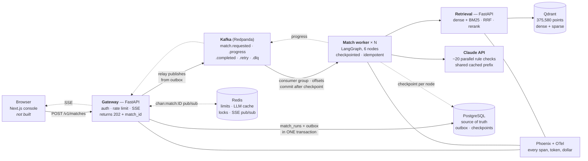

# Beacon

**Clinical-trial matching: a patient note in, a ranked list of trials out, with
every eligibility decision traced to the sentence it came from.**

> **Decision support, not medical advice.** Beacon is a research and portfolio
> system evaluated on the public TREC Clinical Trials benchmark with
> **synthetic** patient notes. It has no clinical validity, it must not be used
> for care decisions, and no real patient record should ever be entered into it.

**Status: Wave 1. Not yet runnable end to end, and no results have been
measured.** The contracts, the LLM layer, the public API and the benchmark
loaders are merged; retrieval, the match pipeline and ingestion are declared but
empty. Every performance figure below is an explicit placeholder in braces —
see the [placeholder index](#placeholder-index). Nothing in this file is an
estimate dressed up as a measurement.

---

## Demo

<!-- DEMO PLACEHOLDER
     A 2-minute GIF or video goes here once the pipeline runs end to end.
     Script (guide §18.3):
       1. the problem in one sentence                             15 s
       2. paste a TREC patient note, watch live SSE progress      30 s
       3. open the top trial: rule table, click a rule to
          highlight its evidence sentence                         30 s
       4. the patient summary and the missing-facts list          15 s
       5. kill a worker mid-run, show the job resume              15 s
       6. results vs BM25 and TrialGPT, then cost per patient     15 s
     Record it against the console at http://localhost:3000.
-->

> **Demo not recorded yet.** There is no console and no end-to-end run to film.
> A placeholder is kept here rather than a screenshot of something that does not
> work.

---

## What it does

375,580 trials cannot go into a prompt, so the work splits in two, and that
split is what "RAG" means here:

| Stage | Cost | Does |
|---|---|---|
| **Retrieve** | milliseconds, no LLM, $0 | 375,580 → ~100 → ~20 candidates |
| **Read** | seconds, ~20 parallel Claude calls | judges every eligibility rule of those ~20 |

Retrieval decides what Claude is *allowed to see*, so a good trial dropped there
can never be recovered. That is why **Recall@100** is the metric that governs
the whole system.

The pipeline: profile the patient → generate 3 facet-diverse queries → hybrid
dense + BM25 search with age/sex filters applied **inside** the index traversal
→ fuse with RRF (k=60) → cross-encoder rerank to ~20 → judge each rule with a
cited sentence ID → verify the citations → rank and explain.

Three independent layers decide different things, and only one of them decides
eligibility:

| Layer | Answers | Numerically reliable |
|---|---|---|
| Embeddings + BM25 + reranker | is this trial *about* the right disease? | no, and it does not need to be |
| Hard payload filters | exact range comparison on typed fields | yes |
| LLM rule checker | does this patient meet *this* rule? | yes, with a citation |

Embeddings cannot compare numbers — a 24-year-old's note will happily retrieve a
trial requiring age 25+, with a high score. That is not a bug, because retrieval
never decides eligibility. And `NULL` age means "possibly eligible", never
"exclude", because a wrongly excluded trial never appears anywhere for anyone to
notice.

---

## Architecture



The retrieval funnel, stage by stage:

```
     375,580 trials  ── the whole TREC CT corpus
            │   1 profile   2 queries (N=3)   3 hybrid search
            │   4 RRF fuse (k=60)             5 age/sex filters INSIDE the search
            ▼
       ~100 candidates
            │   6 cross-encoder rerank          ~1 s · $0
            ▼
        ~20 candidates
            │   7 check_rules  ~20 parallel Claude calls, cached prefix  (~95% of spend)
            │   8 verify       citations exist AND support the label
            │   9 rank + explain
            ▼
       1 ranked answer, every rule cited
```

The per-stage timings in `Beacon_System_Design.pdf` (~50 ms search, ~1 s rerank,
~60 s read) are **design-time estimates, not measurements**; Beacon's own
latencies are `{p50_latency}` / `{p95_latency}`.

Full detail, with everything pinned to the code that implements it:
**[`docs/ARCHITECTURE.md`](docs/ARCHITECTURE.md)**.

---

## Results

**Nothing here has been measured yet.** The evaluation harness does not exist,
so every cell is a placeholder. A number appears in this table only after it has
been produced by a run against held-out TREC CT 2022 and recorded in the
`eval_runs` table.

### Headline — TREC Clinical Trials 2022, held out (50 topics)

Tuned exclusively on 2021. No number measured on 2021 appears here
([ADR 0006](docs/adr/0006-2021-2022-tuning-split.md)).

| Configuration | nDCG@10 (95% CI) | P@10 (95% CI) | Recall@100 (95% CI) | Cost / patient |
|---|---|---|---|---|
| BM25 only (standard keyword baseline) | `{nDCG@10 ± CI}` | `{P@10 ± CI}` | `{recall@100 ± CI}` | $0 |
| Hybrid + cross-encoder rerank, no LLM | `{nDCG@10 ± CI}` | `{P@10 ± CI}` | `{recall@100 ± CI}` | $0 |
| Full Beacon — Haiku 5.5 | `{nDCG@10 ± CI}` | `{P@10 ± CI}` | `{recall@100 ± CI}` | `{cost_per_patient_haiku}` |
| **Full Beacon — Sonnet 5.5 (headline)** | `{nDCG@10 ± CI}` | `{P@10 ± CI}` | `{recall@100 ± CI}` | `{cost_per_patient_sonnet}` |
| TrialGPT (as reported in its paper) | `{trialgpt_nDCG@10}` | `{trialgpt_P@10}` | `{trialgpt_recall@100}` | n/a |

With 50 test topics a 2-point difference is very likely noise, so bootstrap
confidence intervals and paired significance tests (`ranx`) accompany every
figure. A difference without an interval is not a result.

The TrialGPT row will be **transcribed from the published paper with a
citation**, never recalled from memory, and will be labelled as a reported
figure rather than one Beacon measured.

### Ablations

Each row is one `RetrievalSettings` change, which is why the settings object has
no literals buried in prompts. Every row is allowed to come out negative — the
age/sex filter row especially, since the filter is only as good as the age
parsing.

| Configuration | What it tests | nDCG@10 | Recall@100 | Δ vs row above |
|---|---|---|---|---|
| BM25 only | classic keyword baseline | `{nDCG@10}` | `{recall@100}` | — |
| Dense only (`bge-small-en-v1.5`) | general-purpose embeddings | `{nDCG@10}` | `{recall@100}` | `{delta}` |
| Hybrid, RRF k=60 | does combining help? | `{nDCG@10}` | `{recall@100}` | `{delta}` |
| + LLM query generation (N=3 vs N=1) | does rewriting the note into queries help recall? | `{nDCG@10}` | `{recall@100}` | `{delta}` |
| + cross-encoder rerank | does reranking improve the top 10? | `{nDCG@10}` | `{recall@100}` | `{delta}` |
| + age/sex filters | do hard filters help, or wrongly drop trials? | `{nDCG@10}` | `{recall@100}` | `{delta}` |
| + LLM rule-level matching | the full system on graded TREC labels | `{nDCG@10}` | `{recall@100}` | `{delta}` |
| Phase 2: MedCPT embeddings | does a biomedical model beat a general one? | `{nDCG@10}` | `{recall@100}` | `{delta}` |
| Phase 2: rule-level chunks + contextual headers | does indexing individual rules help? ([ADR 0004](docs/adr/0004-trial-level-vs-rule-level-indexing.md)) | `{nDCG@10}` | `{recall@100}` | `{delta}` |

Sweep ranges, all on 2021: `query_count` ∈ {1, 3, 5, 10}; `rrf_k`; `fuse_top_k`;
`rerank_top_k`; `use_rerank`; `apply_age_sex_filters`.

### Trustworthiness and operations

| Metric | Why it matters | Value |
|---|---|---|
| Invalid citation rate | citations to sentences that do not exist; a code check, so it must be exactly 0% | `{invalid_citation_rate}` |
| Evidence faithfulness | share of judgments whose cited sentence really supports the label — its inverse is the hallucination rate | `{faithfulness}` |
| Rule accuracy | are individual rule judgments right, against ~150–200 hand labels | `{rule_accuracy}` |
| Eligible-vs-excluded agreement | does Beacon's category match the experts' | `{eligibility_accuracy}` |
| LLM-judge calibration | Cohen's κ against ~60 hand labels; below ~0.6 the judge's numbers are opinions | `{judge_kappa}` |
| Readability of patient summaries | `textstat`, target ≈ US grade 8 | `{reading_grade}` |
| Latency per patient | p50 / p95, from the audit log | `{p50_latency}` / `{p95_latency}` |
| Fairness slices | metrics by patient age group and sex; an aggregate can hide a system that works for some patients and not others | `{fairness_slice_age}` / `{fairness_slice_sex}` |

### Placeholder index

Everything B3 (the evaluation agent) has to fill in. Any brace in this
repository is one of these.

| Placeholder | Source | Appears in |
|---|---|---|
| `{nDCG@10}`, `{nDCG@10 ± CI}` | `ranx` over held-out 2022 qrels | README, ADR 0006 |
| `{P@10}`, `{P@10 ± CI}` | same | README |
| `{recall@100}`, `{recall@100 ± CI}` | same | README, ARCHITECTURE §4, ADR 0004 |
| `{MRR}` | same | ARCHITECTURE §11 |
| `{delta}` | paired comparison between adjacent ablation rows | README |
| `{hybrid_vs_dense_delta}` | the hybrid-vs-dense ablation pair | ARCHITECTURE §4 |
| `{eligibility_accuracy}` | eligible (2) vs excluded (1) agreement on TREC qrels | README, ARCHITECTURE §11 |
| `{rule_accuracy}` | ~150–200 hand-labelled rule judgments | README, ARCHITECTURE §11 |
| `{faithfulness}` | verifier pass rate + hand-checked sample | README, ARCHITECTURE §5 and §11 |
| `{invalid_citation_rate}` | code check against `NumberedNote.valid_ids` | README, ARCHITECTURE §11 |
| `{judge_kappa}` | Cohen's κ, Opus 5.5 judge vs ~60 hand labels | README, ADR 0005, ARCHITECTURE §11 |
| `{reading_grade}` | `textstat` on generated patient summaries | README, ARCHITECTURE §11 |
| `{cost_per_patient_haiku}`, `{cost_per_patient_sonnet}` | `llm_calls` audit log | README, ADR 0005, ARCHITECTURE §11 |
| `{cost_full_run_sonnet}` | `llm_calls`, summed over the held-out run | ADR 0005 |
| `{p50_latency}`, `{p95_latency}` | `match_runs` timings | README, ARCHITECTURE §11 |
| `{fairness_slice_age}`, `{fairness_slice_sex}` | sliced metrics on held-out 2022 | README, ADR 0006 |
| `{trialgpt_nDCG@10}`, `{trialgpt_P@10}`, `{trialgpt_recall@100}` | **transcribed from the TrialGPT paper, with citation** | README |

---

## Run it

Developed natively on Windows 11 against Docker Desktop. CI runs Ubuntu, so the
code stays path-agnostic. `tasks.ps1` is a thin wrapper, not a build system —
every command it runs is written out below, so a Linux cloner needs no
PowerShell.

### The one command

With Docker Desktop running:

```powershell
docker compose -f deploy/compose.yaml up -d --wait
```

`--wait` is the point: it blocks until every container reports **healthy**, not
merely *running*. All five health checks are deliberate — `pg_isready` over TCP
*plus* a `SELECT 1` against the `beacon` database (so Alembic cannot race
`init.sql`), `redis-cli ping` (so a server still loading its AOF stays
unhealthy), Qdrant's `/readyz` (not `/healthz`, which answers 200 while the
collection is still unusable), and `rpk cluster health` (so a controller with no
leader does not pass).

### From a clean clone

```powershell
# 1. Install uv, once, then restart the shell
irm https://astral.sh/uv/install.ps1 | iex

# 2. Install the workspace from the lockfile
uv sync --locked

# 3. Configure
Copy-Item .env.example .env          # then set ANTHROPIC_API_KEY

# 4. Start the five backing services and wait for healthy
docker compose -f deploy/compose.yaml up -d --wait

# 5. Create the schema
uv run alembic upgrade head

# 6. Check it
.\tasks.ps1 imports                  # every workspace package imports
.\tasks.ps1 check                    # ruff + format + mypy + pytest, exactly what CI runs
```

### Host ports

**Postgres is on 15432 and Redis on 16379, not the defaults.** The dev machine
already runs a native PostgreSQL 18 on 5432 and another compose project's Redis
on 6379. Container-internal ports are unchanged, and
`beacon_core.settings` defaults match the published ports, so a normal local run
needs no env override.

| Service | Host | Container |
|---|---|---|
| PostgreSQL | **15432** | 5432 |
| Redis | **16379** | 6379 |
| Qdrant (HTTP) | 6333 | 6333 |
| Redpanda (Kafka) | 9092 | 19092 |
| Phoenix (UI + OTLP/HTTP) | 6006 | 6006 |
| Gateway | 8000 | — |
| Retrieval | 8001 | — |

### Every task, written out

| Task | Command it runs |
|---|---|
| `sync` | `uv sync --locked` |
| `imports` | `uv run python -c "import beacon_core, beacon_llm, gateway, retrieval, match_worker, ingestion, evals"` |
| `up` | `docker compose -f deploy/compose.yaml up -d` then `ps` |
| `down` / `ps` / `logs` | `docker compose -f deploy/compose.yaml down` / `ps` / `logs -f` |
| `lint` / `fmt` / `types` | `uv run ruff check .` / `ruff format .` / `mypy .` |
| `test` | `uv run pytest -m "not integration"` |
| `test-all` | `uv run pytest` (needs the stack up) |
| `check` | `ruff check` + `ruff format --check` + `mypy` + unit tests |
| `migrate` | `uv run alembic upgrade head` |
| `revision` | `uv run alembic revision --autogenerate -m "..."` — **orchestrator only**; two agents generating revisions in parallel produce two heads |
| `gateway` | `uv run uvicorn gateway.main:app --reload --port 8000` |
| `retrieval` | `uv run uvicorn retrieval.main:app --reload --port 8001` — **fails today**; `retrieval.main` does not exist yet |

`.\tasks.ps1 up` checks `docker info` first and says plainly if Docker Desktop
is not running, because that is the single most common local failure and its
native error is unhelpful.

### Look at the benchmark data

No API key and no stack needed; downloads tens of KB:

```powershell
uv run python -m evals.trec --topic 2021 --first
```

Prints the dataset ID, the topic and qrels counts, the first patient note, and
that topic's grade histogram. Point `BEACON_IR_DATASETS_HOME` at a directory
outside the repo first — the corpus archives are about 1.79 GB compressed and
must never land in a git worktree.

### Verification status of these instructions

Run and observed to succeed in this worktree (a fresh checkout of `master`) on
2026-11-08:

- `uv sync --locked` — installed the workspace clean
- `uv run python -c "import beacon_core, beacon_llm, gateway, retrieval, match_worker, ingestion, evals"` — all seven import
- `uv run pytest -m "not integration"` — 169 passed
- `uv run ruff check .` — clean
- `uv run alembic current` — reports `0001_initial (head)` against the running stack
- `docker compose -f deploy/compose.yaml ps` — all five services healthy
- `uv run python -m evals.trec --topic 2021 --first` — 75 topics, 35,832 qrels

Verified by reading the file that runs them, **not** executed: `uv sync` from a
truly empty cache, `docker compose up -d --wait` (the stack was already up and
shared with other work, so it was not torn down), `alembic upgrade head` (the
schema was already at head), `mypy .`, and both `uvicorn` commands.

---

## Design decisions

One page each, with context, the options considered, the decision and its
consequences. Index: [`docs/adr/`](docs/adr/README.md).

| ADR | Decision | The real reason |
|---|---|---|
| [0001](docs/adr/0001-qdrant-vs-pgvector.md) | Qdrant alongside Postgres, not pgvector | **Not scale.** 375,580 × 384-dim vectors is ≈576 MB — small for any engine. The reason is BM25: Postgres `tsvector`/`ts_rank` is a different ranking function, so a pgvector build would either add ParadeDB's `pg_search` or lose the standard keyword baseline that TREC and TrialGPT results are compared against. The admitted cost is the Postgres-then-Qdrant dual write, which is why ingestion is resumable and idempotent by `nct_id` |
| [0002](docs/adr/0002-kafka-vs-redis-streams.md) | Kafka (Redpanda), not Redis Streams | Redis Streams is a real queue, but `appendfsync everysec` can lose a second of acknowledged writes and retention is trimming rather than a replayable log. Kafka gives offsets committed *after* the checkpoint, ordered per-job events, retry→DLQ, and replay for evaluation. The cost is another container, two advertised listeners, and the transactional outbox |
| [0003](docs/adr/0003-langgraph-raw-sdk-vs-langchain.md) | LangGraph + the raw Anthropic SDK, not LangChain | Prompt-cache block ordering, the raw `usage` object and structured outputs against a frozen schema all fail **silently** through a wrapper. LangGraph keeps the graph; nothing sits between Beacon and the SDK |
| [0004](docs/adr/0004-trial-level-vs-rule-level-indexing.md) | One point per trial, overview text only | The answer unit is a trial and qrels are per (topic, NCT ID); `bge-small-en-v1.5` truncates silently at 512 tokens, so eligibility text would push the title and conditions out of the window. There are three separate splitting decisions here, not one chunking method |
| [0005](docs/adr/0005-model-choice-and-cost.md) | Haiku 5.5 for dev and bulk, Sonnet 5.5 for the single headline run, Opus 5.5 as judge only | ~95% of spend is one stage; Haiku has a **5× price cliff at 100,000 prompt tokens that counts cache reads**; cache reads are 0.1× on Haiku but 0.05× on Sonnet and Opus. A judge must differ from the model it grades |
| [0006](docs/adr/0006-2021-2022-tuning-split.md) | Tune on TREC CT 2021, report on held-out 2022 | The only honest generalisation claim available. Also: the graded qrels (2 eligible > 1 excluded > 0 not relevant) are why retrieval is scored on relevance while eligibility is the LLM's job |

---

## Known limitations

Stated plainly, because an honest limitation section is worth more than a
flattering one.

**Not finished**

- **No results exist.** The evaluation harness is not built. Every figure in
  this README is a placeholder.
- **Not runnable end to end.** `services/retrieval`, `services/match_worker` and
  `services/ingestion` are package skeletons. There is no index, no pipeline and
  no console; `web/` does not exist yet.
- **`beacon_core.telemetry` is a deliberate no-op stub.** The signatures are
  frozen so services can call `setup_tracing(...)` today and get real spans
  later with no edit, but there are no traces yet.
- **`.\tasks.ps1 retrieval` fails**, because `retrieval.main` has not been
  written.

**Scientific limits of what could ever be claimed here**

- **The patients are synthetic.** TREC CT topics are written to read like
  admission notes; no real patient record is involved, which is why there is no
  privacy issue and also why **no clinical conclusion follows from any number
  this project produces**.
- **The trial snapshot is from April 2021.** Both the 2021 and 2022 tracks share
  it, so nothing measured here says anything about today's ClinicalTrials.gov.
- **Fifty held-out topics is a small test set.** Confidence intervals will be
  wide and a 2-point difference is probably noise.
- **TrialGPT comparison is against published figures**, not a re-run of its
  code, unless budget allows otherwise. That will be labelled as such.
- **The LLM judge is calibrated, not authoritative.** Below κ ≈ 0.6 its numbers
  are opinions; the κ is reported next to anything it scored.
- **The tuned configuration is tuned on Haiku but the headline runs on Sonnet.**
  Mitigated by reporting both rows, not by assuming the gap away
  ([ADR 0005](docs/adr/0005-model-choice-and-cost.md)).

**Architectural limits already identified**

- **The CPU cross-encoder is bottleneck #1** — the design docs estimate roughly
  100 query-trial pairs per second (an estimate, not a measurement), and it
  cannot be precomputed. Fixes: GPU, ONNX int8, batching, or caching
  `(query, trial)` scores.
- **LLM cost and latency is bottleneck #2**, linear in patients × trials.
- A single Qdrant node is bottleneck **#3**, biting only around 10M+ vectors.
- Analytics on `llm_calls` will eventually compete with writes on the Postgres
  primary.
- **Rule parsing sits on the hot path**, lazily per retrieved trial and cached.
  Fine at current churn; the fix is the phase-2 offline rule index.
- **No HIPAA/PHI story, no FHIR/EHR integration, no bias audit, no clinical
  validation.** Those are the answer to "what would a hospital need?", and all
  four are out of scope.

---

## Layout

A `uv` workspace. Every package is importable from day one, even where the body
is a stub — that is what makes "CI green" mean something.

```
libs/beacon-core/        MERGED   schemas, settings, models, db, logging, redis, kafka,
                                  events, protocols; telemetry is a no-op stub
                                  FROZEN CONTRACTS - read-only to every agent after Wave 0
libs/beacon-llm/         MERGED   Claude wrapper: structured outputs, cache-ordered prompts,
                                  price table, cost meter, token guard, record/replay
services/gateway/        MERGED   FastAPI: health, /v1/matches, SSE, streaming chat
services/retrieval/      SKELETON hybrid search + RRF + rerank (contract already frozen)
services/match_worker/   SKELETON LangGraph pipeline, Kafka consumer
services/ingestion/      SKELETON TREC corpus to Postgres + Qdrant
evals/                   PARTIAL  evals.trec loaders + CLI merged; metrics and reports pending
alembic/                 MERGED   0001_initial creates all ten tables (orchestrator-owned)
deploy/                  MERGED   compose.yaml (five pinned, health-checked services) + init.sql
tests/                   MERGED   unit + integration, plus recorded LLM fixtures
docs/                    ARCHITECTURE.md, adr/0001-0006, AGENT_BRIEFS.md
```

## Design documents

| File | What it is for |
|---|---|
| [`docs/ARCHITECTURE.md`](docs/ARCHITECTURE.md) | **the code as merged**, with every claim pinned to a file |
| [`docs/adr/`](docs/adr/README.md) | the six ADRs: context, options, decision, consequences |
| `docs/AGENT_BRIEFS.md` | how the work is split across agents, with the file-ownership matrix |
| `Beacon_Project_Guide.pdf` | the spec: what to build, day by day |
| `Beacon_System_Design.pdf` | flowcharts, toolkit, contracts |

`Beacon_Design_Decisions.pdf` is referenced by the other two PDFs but is **not
present in this repository**; the ADRs were reconstructed from the guide, the
system-design reference, the agent briefs and the merged code. Where the PDFs
and the code disagree, the code wins — the open discrepancies are listed in
[`docs/ARCHITECTURE.md` §12](docs/ARCHITECTURE.md#12-where-the-pdfs-and-the-code-disagree).

## Data sources

Official sources only, no scraping of third-party aggregators:

- **TREC Clinical Trials 2021/2022** via `ir_datasets` (NIST) — the corpus of
  **375,580 trials**, 125 synthetic patient topics (75 in 2021, 50 in 2022), and
  expert graded relevance judgments. Dataset IDs are
  `clinicaltrials/2021/trec-ct-2021` and `clinicaltrials/2021/trec-ct-2022`:
  **both hang off the 2021 collection**, because TREC CT 2022 reused the
  April-2021 snapshot and there is no `clinicaltrials/2022`. `ir_datasets` ships
  no 2022 qrels, so those are fetched from the official NIST file
  (`qrels2022.txt`) with its md5 pinned.
- **ClinicalTrials.gov API v2** — the official JSON REST API, phase 2 only.

Judgments are graded **2 / 1 / 0 = eligible / excluded / not relevant**, and
"excluded" scores *above* "not relevant" — the benchmark asserting that a
right-disease-wrong-eligibility trial is partially correct *retrieval*. That is
why retrieval is measured on relevance while eligibility is the LLM's job, and
why the grade must never be collapsed to a boolean.

Claude's web search stays **out** of the matching loop entirely: every citation
must resolve into the indexed corpus, or the faithfulness metric measures
nothing. Only the ingestion job touches the network.

Tuning happens on the 2021 split. Headline numbers come from held-out 2022, and
no number is published that was not measured there.
