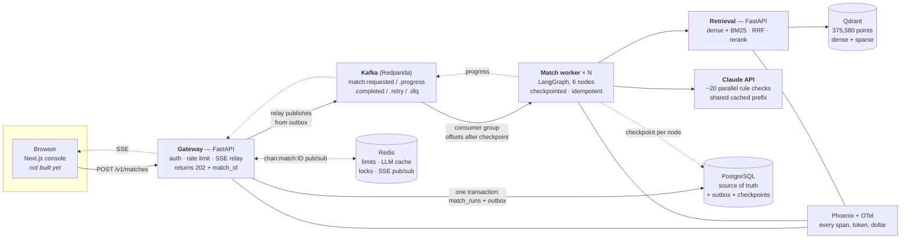

# Beacon — architecture

> **Decision support, not medical advice.** Evaluated on a public benchmark
> with **synthetic** patient notes. No clinical validity is claimed anywhere in
> this document.

This describes **the code that is merged**, not the plan. Where the design PDFs
and the code disagree, the code wins and the disagreement is recorded in
[§12](#12-where-the-pdfs-and-the-code-disagree).

The *why* behind each structural choice lives in the ADRs:
[0001](adr/0001-qdrant-vs-pgvector.md) ·
[0002](adr/0002-kafka-vs-redis-streams.md) ·
[0003](adr/0003-langgraph-raw-sdk-vs-langchain.md) ·
[0004](adr/0004-trial-level-vs-rule-level-indexing.md) ·
[0005](adr/0005-model-choice-and-cost.md) ·
[0006](adr/0006-2021-2022-tuning-split.md)

---

## 1. What exists today

| Package | State | Owner |
|---|---|---|
| `libs/beacon-core` | **merged** — schemas, settings, ORM models, db, redis, kafka factories, events, logging, protocols; `telemetry` is a deliberate no-op stub | Wave 0, frozen |
| `libs/beacon-llm` | **merged** — client, prompt, pricing, cost, guard, fixtures, capabilities, errors | A3 |
| `services/gateway` | **merged** — health, `POST /v1/matches`, SSE events, streaming chat | A2 |
| `evals` | **partial** — `evals.trec` loaders and CLI merged; metrics, ablations and reports not yet built | B3 |
| `alembic` | **merged** — `0001_initial` creates all ten tables | orchestrator |
| `deploy/compose.yaml` | **merged** — five backing services, all pinned, all health-checked | A1 |
| `services/retrieval` | **skeleton** — `__init__.py` only; HTTP contract already frozen in `beacon_core.schemas` | B2 |
| `services/match_worker` | **skeleton** — `__init__.py` only | C1 |
| `services/ingestion` | **skeleton** — `__init__.py` only | B1 |
| `web/` (Next.js console) | **not present** | later |

So: the contracts, the LLM layer, the public API and the benchmark loaders are
real. Retrieval, the pipeline and ingestion are declared but empty. Nothing is
runnable end to end yet.

---

## 2. The request path



Numbered, as the code does it:

1. `POST /v1/matches` with a patient note. The gateway validates, resolves or
   creates the `patients` row, and returns **202** with a `match_id` and a
   `Location` header. 202 because nothing has been matched yet.
2. The `match_runs` row **and** its `outbox` row are written in **one
   transaction** (`gateway.router.create_match`). Committing the job and then
   publishing to Kafka are two operations that can half-fail; one transaction
   plus a relay makes a queued job and its event impossible to desynchronise.
3. A relay publishes `match.requested` from `outbox`, keyed by `match_id` so one
   job's events stay ordered on one partition.
4. A worker in the consumer group picks it up. `enable_auto_commit=False`
   (`beacon_core.kafka`): the offset is committed *after* the checkpoint is
   written, never before.
5. The worker calls the retrieval service: 375,580 → ~100 → ~20 candidates.
6. It fans out ~20 parallel Claude calls, one per trial, sharing a cached prompt
   prefix.
7. Results land in Postgres, `match.completed` is published, and progress is
   streamed to the browser throughout via `chan:match:{id}` → SSE.

Steps 3–7 are not yet implemented. Steps 1–2 are.

---

## 3. Three layers decide, and only one of them decides eligibility

This is the single most important thing to understand about Beacon, and it is
encoded in the types rather than left to documentation.

| Layer | Answers | Numerically reliable? |
|---|---|---|
| Embeddings + BM25 + cross-encoder | is this trial *about* the right disease? | **no**, and it does not need to be |
| Hard payload filters (`AgeSexFilter`) | exact range comparison on typed fields | **yes** |
| LLM rule checker (`CriterionJudgment`) | does this patient meet *this* rule? | **yes, with a citation** |

**Embeddings cannot compare numbers.** A 24-year-old's note will retrieve a
trial requiring age 25+, with a high similarity score. That is not a bug,
because retrieval never decides eligibility. `PatientProfile.age` is a typed
`int | None` "precisely because embeddings cannot compare numbers: every numeric
eligibility decision is made against this field or against the trial's typed age
bounds, never against a similarity score."

Two corollaries the code enforces:

- **`NULL` means *possibly eligible*, never *exclude*.** `AgeSexFilter.include_unknown`
  defaults to `True` and the docstring says it must stay that way: the filter
  excludes only on *positive evidence of ineligibility*. ClinicalTrials.gov age
  and sex fields are frequently absent or unparseable, and **a wrongly excluded
  trial never appears anywhere for anyone to notice.** The `trials` table keeps
  `raw_min_age` / `raw_max_age` alongside the parsed floats for exactly this
  reason.
- **Filters are applied *inside* both searches, never afterwards.** Post-filtering
  the top-k is the overfiltering bug: with `ef_search=40` and a filter matching
  10% of rows you average four survivors out of forty, so "top 20" silently
  returns 4.

---

## 4. The retrieval funnel

```
     375,580 trials  ── the whole TREC CT corpus
            │
            │  1 profile_patient     note → typed PatientProfile + NumberedNote
            │  2 generate_queries    N = 3, facet-diverse (not paraphrases)
            │  3 hybrid search       dense ANN + BM25, filters INSIDE both
            │  4 RRF fuse            k = 60, within each query then across
            │  5 hard filters        age / sex, NULL-safe  ── a constraint, not a stage
            ▼
       ~100 candidates
            │
            │  6 cross-encoder rerank    bge-reranker-base, ~1 s, $0
            ▼
        ~20 candidates
            │
            │  7 check_rules     ~20 parallel Claude calls, shared cached prefix
            │  8 verify          citations exist AND support the label
            │  9 rank_and_explain  clinician view, patient summary, missing facts
            ▼
       1 ranked answer, every rule cited
```

Steps 1–6 are retrieval: **no LLM reads a trial and nothing costs money.**
Steps 7–9 are the read stage, and roughly **95% of all token spend is step 7**.

> The latencies in that diagram (~50 ms hybrid search, ~1 s rerank, ~60 s for
> the read stage) are **design-time estimates from `Beacon_System_Design.pdf`
> §2, not measurements.** Beacon's own figures will be `{p50_latency}` /
> `{p95_latency}`, from `match_runs`. The 95%-of-spend split is from the same
> source and is likewise an estimate.

Every knob in that funnel is a field on `RetrievalSettings`, deliberately not a
literal, so an ablation is a config change rather than an edit:
`query_count=3`, `fuse_top_k=100`, `rerank_top_k=20`, `rrf_k=60`,
`use_rerank=True`, `apply_age_sex_filters=True`. The retrieval service is
reached only through `SearchRequest` / `SearchResponse`, which name no engine.

**Recall@100 governs the whole system.** A good trial dropped at stage 3 can
never be recovered by anything downstream, because the LLM is only ever shown
what retrieval allowed through. The measured value is **{recall@100}**.

Why hybrid rather than dense alone: medical text has two kinds of match. Exact
tokens — `EGFR`, `BRCA1`, `HbA1c`, `eGFR` — must match exactly, which BM25 does
and embeddings blur. Meaning — "kidney function normal" ↔ "adequate renal
function" — is what dense embeddings are for. The claim that running both beats
either is an **ablation row**, currently **{hybrid_vs_dense_delta}**, not an
assertion.

---

## 5. The read stage: rule-level judging with checkable citations

The patient note is split into **numbered sentences**. For each candidate trial,
one Claude call receives the standing instructions, the numbered note and that
trial's rules, and must return one `CriterionJudgment` per rule:

```python
class CriterionJudgment(Contract):          # beacon_core.schemas — FROZEN
    criterion_id: str
    kind: Literal["inclusion", "exclusion"]
    label: Literal["met", "not_met", "insufficient_info", "not_applicable"]
    evidence_sentence_ids: list[int]        # must point at real sentences
    explanation: str
```

Exactly five fields, frozen: this is the JSON schema handed to
`client.messages.parse()`, so adding a field changes the schema sent to Claude,
busts the cached prompt prefix and invalidates every recorded fixture.

- **Citations are checkable before any model is consulted.** `NumberedNote.valid_ids`
  exists so plain code can assert every cited ID is real. The invalid-citation
  rate should be exactly 0% and is a code check, not a judgement call.
- **Then a cheaper second pass asks whether the cited sentence actually
  *supports* the label.** That is the `verify` node, and the inverse of its pass
  rate is the hallucination rate: **{faithfulness}**.
- **`insufficient_info` is a success state, not a failure.** It is how the
  system abstains instead of guessing, and it is what feeds
  `TrialJudgment.missing_facts`.
- **Scoring:** a trial is `excluded` if any inclusion rule is `not_met` or any
  exclusion rule is `met`; otherwise it is ranked by `confirmed_fraction` and
  then by retrieval score. The formula is tuned on 2021 only (ADR 0006).

### Why the prompt is ordered the way it is

One patient means ~20 calls sharing two large blocks and differing only in one
trial's rules. `beacon_llm.prompt.CachedPrompt` renders three fixed slots:

| Slot | Lands in | Cached? |
|---|---|---|
| `instructions` (stable) | `system[0]` | yes |
| `note` (per patient) | `system[1]` + cache breakpoint | yes, up to here |
| `variable` (per trial) | the user turn | no |

Nineteen of twenty calls then read that prefix back at 0.1× (Haiku) or 0.05×
(Sonnet/Opus) of input price. Put the trial rules first and the prefix is no
longer byte-identical: every call pays full price, and **nothing fails** — no
error, no warning, a bill 5–20× larger. Hence there is no constructor taking a
list of blocks and no parameter that reorders them. See ADR 0005.

---

## 6. Ingestion and the dual write

```
  one ClinicalTrials.gov record (NCT########)
                  │
   overview_text = title + conditions + interventions + brief summary
   assembled MOST-DISCRIMINATIVE-FIELD-FIRST — bge-small truncates at
   512 tokens silently, and overview_truncated / overview_token_count
   are recorded per row so the truncation rate is a measurable thing
                  │
        ┌─────────┼──────────────┬────────────────────────┐
        ▼         ▼              ▼                        ▼
   dense vector  sparse vector  structured payload    PostgreSQL
   bge-small     BM25 with      min_age_years,        trials  +
   -en-v1.5      modifier=IDF   max_age_years, sex,   trial_criteria
   384 floats    EGFR, HbA1c    phase, status         (rules, lazily)
        └─────────┴──────────────┘
                  ▼
   ONE Qdrant point · named vectors 'dense' + 'sparse'
   filterable payload · idempotent by nct_id
```

- **375,580 × 384 dims × 4 bytes ≈ 576 MB** of dense vectors plus a small sparse
  index. That figure is arithmetic, not a benchmark. The "one CPU pass, roughly
  30–90 minutes" build time is the design docs' **estimate**; the real number
  arrives with the first ingestion run. Re-running it changes nothing.
- **`modifier=IDF` on the sparse field is not optional.** BM25 needs
  corpus-level IDF and Qdrant computes it only when the field is declared that
  way. Omitting it raises no error and silently degrades rare-term matching,
  which is the entire reason BM25 is in the system
  (`QdrantSettings.sparse_idf_modifier`).
- **Eligibility text is stored in Postgres and is *not* indexed.** It is split
  into rules lazily for retrieved trials only and cached in `trial_criteria`,
  unique on `(nct_id, criterion_id)`. See ADR 0004 for why, and for the three
  separate splitting decisions this system makes.
- **The dual write is the price of ADR 0001.** Postgres first, then Qdrant —
  the only place in Beacon where two stores can drift apart. The ingest job is
  therefore required to be resumable and **idempotent by `nct_id`**, which is
  the primary key of `trials`.

### The corpus, correctly sized

The archives `ir_datasets` downloads for the 2021 collection are five zips
(`docs_2021_1.zip` … `docs_2021_5.zip`) totalling **about 1.79 GB compressed**,
roughly **2.6 GB** once `ir_datasets` builds its own store alongside them. The
project guide's "about 25 GB free disk" figure is wrong for the corpus itself,
and `evals.trec` says so in `CORPUS_ZIP_NAMES`. Size the volume generously, but
do not repeat "tens of GB".

---

## 7. Frozen contracts

Fixed in Wave 0, read-only to every agent afterwards. Changing one is an
orchestrator action, applied everywhere at once.

### `beacon_core.schemas`

Every model inherits `Contract`, whose only job is `extra="forbid"` — an unknown
field is a loud error, not a silently ignored one.

`NoteSentence` · `NumberedNote` · `PatientProfile` · `RankedQuery` ·
`TrialCandidate` · `CriterionJudgment` · `TrialJudgment` · `RankedTrial` ·
`AgeSexFilter` · `SearchRequest` · `SearchResponse` · `MatchState`

Vocabularies are `Literal` types, not strings: `Sex`, `CriterionKind`,
`CriterionLabel`, `EligibilityCategory`, `MatchStatus`, `PipelineStep`,
`QueryFacet`. The database mirrors each one as a `CHECK` constraint, so an
invalid value cannot be persisted even by a caller that bypassed Pydantic.

### The ten tables (`alembic/versions/0001_initial_schema.py`, handwritten)

| Table | Holds |
|---|---|
| `trials` | NCT ID (PK), title, conditions, interventions, phase, status, parsed + raw age bounds, sex, locations, brief summary, eligibility text, `overview_text`, `overview_token_count`, `overview_truncated`, `indexed_at`, `source` |
| `trial_criteria` | one row per rule; unique `(nct_id, criterion_id)` |
| `patients` | synthetic notes, numbered sentences, extracted profile JSON |
| `match_runs` | one row per request: status, timings, tokens, cost, config version |
| `trial_matches` | per patient–trial pair; unique `(match_run_id, nct_id)` |
| `criterion_judgments` | per rule: label, cited sentence IDs, explanation, verifier verdict; unique `(match_run_id, nct_id, criterion_id)` |
| `llm_calls` | audit log: model, prompt hash, input/output/cached tokens, cost, latency, **`billed_tier`**, request ID |
| `feedback` | reviewer corrections, which become future evaluation data |
| `eval_runs` | benchmark results per configuration, indexed by `split` |
| `outbox` | events awaiting publication; unique `event_id`, index on `(published_at, id)` so the relay finds unpublished rows in order |

Those unique constraints are not hygiene — they are how at-least-once Kafka
delivery is made safe. Idempotency is a database constraint, not a convention.

### Kafka topics and Redis keys

`match.requested` · `match.progress` · `match.completed` · `match.retry` ·
`match.dlq` · `trials.updated` — all in `beacon_core.events`.

`rl:{api_key}` (token bucket, atomic Lua) · `idem:{key}` · `llm:{sha256}` ·
`lock:ingest` · `chan:match:{id}` — built only through the helpers in
`beacon_core.redis`, because a typo in a channel name is a bug that appears only
under more than one gateway replica.

---

## 8. The LLM layer

`libs/beacon-llm` is one module per hazard. See ADR 0003 for why none of this is
delegated to a framework.

| Module | Owns | The silent failure it prevents |
|---|---|---|
| `client.py` | `LlmClient` / `AsyncLlmClient`, structured outputs, `stop_reason` and refusal handling, `CallResult.audit_row()` | a refusal read as an answer — a wrong judgment with a confident explanation |
| `prompt.py` | `CachedPrompt`, three fixed slots | variable text in the cached prefix: 5–20× cost, no error |
| `pricing.py` | the price table as data; the Haiku 100K cliff; per-model cache multipliers (0.1× Haiku, 0.05× Sonnet/Opus) | a flat "× 0.1" overcharging the two models the project reports on |
| `cost.py` | `Decimal` arithmetic over the real `Usage`; `CostBreakdown` splits cache-write cost out | float drift across thousands of ~1e-5 USD calls |
| `guard.py` | counts prompt tokens *before* the call; raises `PromptTooLargeError` above the ceiling; runs on the replay path too | "batch all 20 trials into one call" quintupling the bill in silence |
| `fixtures.py` | record/replay by prompt hash; **default `replay`**; **no code path from a miss to the network** | CI spending money; eval diffs caused by model variance rather than code |
| `capabilities.py` | asks `GET /v1/models/{id}` and caches per process | a hardcoded capability table going stale the moment a model ships |
| `errors.py` | typed failures incl. `UnknownModelPriceError` | an unpriced model appearing in `llm_calls` as free |

One finding from `capabilities.py`, checked 2026-11-08 on all three models:
`thinking.types.enabled.supported` is **false**, `adaptive` is **true**, and
`disabled` is false on Sonnet and Opus. There is therefore exactly one thinking
code path — `thinking={"type": "adaptive"}` — with `output_config.effort` as the
only dial.

---

## 9. Reliability, each pattern pinned to code

| Pattern | Where it lives |
|---|---|
| Transactional outbox | `gateway.router.create_match` — `match_runs` + `outbox` in one transaction |
| At-least-once + idempotent consumers | `uq_*` constraints across `trial_matches`, `criterion_judgments`, `trial_criteria`, `outbox` |
| Offsets committed after the checkpoint | `enable_auto_commit=False` in `beacon_core.kafka` |
| Ordered per-job events | partition key is always `match_id` |
| Retry with delay, then DLQ | `match.retry` → `match.dlq` after `KafkaSettings.max_retries` = 3 |
| Durable workflow | LangGraph checkpoint to Postgres after every node |
| Idempotent POST | `idem:{key}` in Redis |
| Token-bucket rate limiting | `rl:{api_key}`, atomic Lua |
| Budgets | per-match and per-day ceilings; a reached ceiling returns **partial results, clearly marked**, never a silent failure |
| Graceful degradation | reranker down → serve RRF results only, flagged |
| Connection-pool discipline | engine cached per process (`beacon_core.db`); pools closed in the gateway `lifespan` |
| Streaming correctness | one terminal SSE event — `error` *or* `done`, never both; errors are typed events with a machine-readable `code`, never prose smuggled into a `token` payload |
| Chat history | Redis-backed `ConversationStore` behind a `Protocol`, not a module-level dict; user and assistant turns persisted *together*, only after the stream completes |

The last two are fixes for defects found in the original spike, and the modules
say so in their docstrings. That provenance is deliberate: these are the failure
modes the project has actually hit.

### Crash test

Start a match, kill the worker container halfway, start it again: Kafka
redelivers, the worker resumes from the last checkpoint, the unique constraints
absorb the repeat, and the match finishes once. Twenty seconds of demo that
nothing else in the project substitutes for.

---

## 10. Observability

- **One trace per request**, propagated gateway → Kafka headers → worker → every
  LangGraph node → every LLM and retrieval call.
- **`beacon_core.telemetry` is currently a deliberate no-op stub.** The
  signatures are frozen so services can call `setup_tracing(...)` today and get
  real spans later with no edit. C3 owns the real implementation and runs with
  no other agent active, because tracing touches every package.
- **Structured logs** via `structlog` — JSON in production, readable colour in
  dev — and every line carries the current trace ID when one exists, so a log
  line joins to a Phoenix span.
- **Dollars are in the database, not only in a UI.** `llm_calls` records model,
  token counts including cached, cost, latency and `billed_tier` per call.
  Without `billed_tier` the Haiku cliff is invisible after the fact: two rows
  with identical token counts can differ 5× and nothing else would say why.

---

## 11. Evaluation

`evals.trec` is merged and verified; the metrics, ablation and report layers are
B3's and not built. See ADR 0006 for the split and for why the graded qrels
shape the metric choices.

Verified by enumerating the `ir_datasets` registry and then fetching the files
(2026-11-08):

| | 2021 | 2022 |
|---|---|---|
| Dataset ID | `clinicaltrials/2021/trec-ct-2021` | `clinicaltrials/2021/trec-ct-2022` |
| Topics | 75 | 50 |
| Qrels | 35,832 `{0: 24243, 1: 6019, 2: 5570}` | 35,394 `{0: 28419, 1: 3036, 2: 3939}` |
| Qrels source | shipped by `ir_datasets` | **fetched from NIST**, md5-pinned |
| Corpus | `clinicaltrials/2021`, 375,580 trials | the same snapshot |

There is **no** `clinicaltrials/2022`. TREC CT 2022 reused the April-2021
snapshot, and a plausible-looking `clinicaltrials/2022/...` ID is a
wrong-corpus bug that imports cleanly.

Grades are **ordinal**: 2 eligible > 1 excluded > 0 not relevant, so "excluded"
scores *above* "not relevant" — the benchmark asserting that a
right-disease-wrong-eligibility trial is partially correct *retrieval*. Hence
retrieval is scored on relevance and eligibility is scored separately as the
LLM's job. Never collapse the grade to a boolean.

Metrics, and where each is measured:

| Metric | Measured on | Value |
|---|---|---|
| nDCG@10, P@10, Recall@100, MRR | TREC qrels, held-out 2022 | `{nDCG@10}` `{P@10}` `{recall@100}` `{MRR}` |
| Eligible-vs-excluded agreement | TREC qrels | `{eligibility_accuracy}` |
| Rule accuracy | ~150–200 hand labels | `{rule_accuracy}` |
| Evidence faithfulness | verifier + hand-checked sample | `{faithfulness}` |
| Invalid citation rate | code check, must be 0% | `{invalid_citation_rate}` |
| LLM-judge agreement | Cohen's κ vs ~60 hand labels | `{judge_kappa}` |
| Readability | `textstat`, target ≈ grade 8 | `{reading_grade}` |
| Cost and latency, p50/p95 | `llm_calls` audit log | `{cost_per_patient_*}` `{p50_latency}` `{p95_latency}` |

CI runs a small (~10-patient) evaluation against **recorded** responses, so it
is free and deterministic; the gate fails on an nDCG@10 drop beyond tolerance or
any invalid citation. The full benchmark runs on demand through the Batches API.

---

## 12. Where the PDFs and the code disagree

The code is the truth. These are open discrepancies, not decisions:

| Topic | PDF says | Code says |
|---|---|---|
| Pipeline node count | `Beacon_System_Design.pdf` §1 and the guide §9 describe **7 nodes**, including a separate `parse_rules` | `beacon_core.schemas.PipelineStep` declares **6**: `profile_patient`, `generate_queries`, `retrieve`, `check_rules`, `verify`, `rank_and_explain`. Rule parsing happens lazily inside retrieval/`check_rules` rather than as its own checkpointed node |
| Host ports for Postgres / Redis | `Beacon_System_Design.pdf` §4 lists 5432 and 6379 | `deploy/compose.yaml` publishes **15432** and **16379**; `PostgresSettings.port` / `RedisSettings.port` default to the same, because the dev machine already runs a native Postgres 18 and another compose project's Redis. Container-internal ports are unchanged |
| Corpus size on disk | guide §4.3 asks for "about 25 GB free"; `evals.trec`'s `DEFAULT_IR_DATASETS_HOME` docstring still says "tens of GB" | `CORPUS_ZIP_NAMES` records the measured **1.79 GB compressed / ~2.6 GB cached** and calls the brief's figure pessimistic. The 25 GB advice also survives in `Settings.ir_datasets_home` and in a runtime warning in `_configure_ir_datasets_home` — three places that should be reconciled by whoever owns those files |
| Qdrant point count | "375K trials" everywhere | **375,580**, verified |
| `Beacon_Design_Decisions.pdf` | referenced by the other two PDFs and by the agent briefs as the source for the ADRs | **not present in the repository.** These ADRs were reconstructed from the guide, the system-design reference, the agent briefs and the merged code |
| Windows strategy | guide §19 says "work inside WSL2" | the repo is developed natively on Windows against Docker Desktop, with `tasks.ps1` as the Makefile stand-in; CI runs Ubuntu so the code stays path-agnostic |
